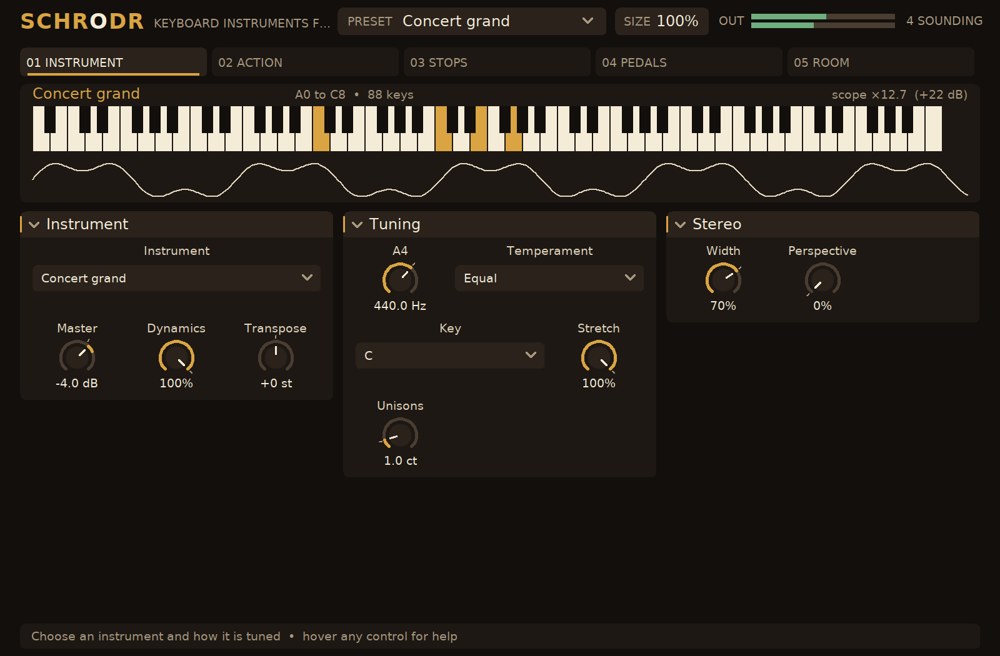

# SCHRODR — keyboard instruments from their physics

Every page: [INSTRUMENT](docs/screenshots/page1.png), [ACTION](docs/screenshots/page2.png),
[STOPS](docs/screenshots/page3.png), [PEDALS](docs/screenshots/page4.png), [ROOM](docs/screenshots/page5.png),
and the [preset menu](docs/screenshots/presets.png).

SCHRODR is a cross-platform CLAP instrument that simulates keyboard instruments from their
physics rather than playing samples of them: pianos from Cristofori's to a concert grand,
harpsichords, virginals and a clavichord, the hurdy-gurdy and the Geigenwerk, the celesta and
its cousins, a chamber organ, and a violin, viola and cello played from the keys. It builds on Linux, Windows and macOS with a native editor
on all three (X11, Win32, Cocoa). It follows the model of [FUZZBOI](https://github.com/andrewfader/fuzzboi): a header-only
physics engine, a thin CLAP shell, a native editor, and a suite that proves every claim from
the audio in the unit the claim is made in.

## What is in it

**Twenty-five instruments**, every one a model of the real thing:

| Instrument | What is simulated |
|---|---|
| Concert grand, upright | 88 keys of real strings (a Steinway D's and a Yamaha U1's scalings: lengths, music wire to 1.5 mm then wound cores, tensions near 700 to 950 N), one to three to a note, felt hammers whose force grows as a power of their compression, a soundboard of measured modes, dampers to F#6, una corda, sostenuto and sustain pedals, the lid |
| Viennese fortepiano, square piano, Cristofori 1720, tangent piano | the same physics at a tenth of the tension: iron and brass wire, leather, paper or bare wood on the hammers, thin boards, knee levers, the moderator |
| Flemish, Italian and French harpsichords, virginal, spinet, Lautenwerck | quills or delrin plectra that lift the string and let go at their own deflection (so the key's speed barely matters), separate strings for the back and front 8' and the 4', the lute and buff stops, jack dampers; gut on the Lautenwerck |
| Fretted and unfretted clavichords | brass tangents that strike and stay, dividing the string; a firm stroke stretches it sharp, aftertouch bends it (bebung); chromatic neighbours share a pair on the fretted one |
| Hurdy-gurdy, Geigenwerk | a rosined wheel bowing gut or iron strings with a stick-slip friction curve: keyed chanterelles over bourdons and a buzzing trompette, or a four-octave bowed keyboard |
| Celesta, glockenspiel, dulcitone, electric piano, toy piano | beams in their bending modes (free-free plates and bars, clamped-free forks, tines and rods, Timoshenko-corrected), mallets through the mode shapes, resonator boxes, a tone bar with a magnetic pickup that barks |
| Violin, viola, cello | each key a string of the instrument, stopped by a finger on the open string a player takes it on (real scale lengths and string tensions, wound and plain), bowed with horsehair at the player's force, speed and distance from the bridge: the Helmholtz motion and Schelleng's limits come from the stick-slip itself; the left hand's vibrato; a body of measured signature modes (A0, CBR, B1-, B1+) and the bridge hill. Key velocity shapes the stroke; aftertouch or the mod wheel leans into the bow |
| Chamber organ | flue pipes: an air jet bent by the mouth's flow and switching its flow into an open or stopped bore, voiced to Töpfer's scale, with the chiff, wind pressure and sag, a tremulant, five stops and the pipes on the C and C# sides of the chest |

**The tuner's work**: six temperaments (equal, Pythagorean, quarter-comma meantone,
Werckmeister III, Kirnberger III, Vallotti) from any key, the reference pitch from 392 to 466 Hz,
the octaves stretched to each string's own inharmonicity the way a tuner does by ear (the
Railsback curve emerges from the strings), and unisons left a cent or a saloon's eight apart.

**The room and its air**: every instrument plays into a room and is heard through air (ISO
9613-1 absorption, the speed of sound, image-source reflections, a Sabine tail) by an omni,
cardioid or figure-8 microphone, as a stereo pair or one mono mic, with its proximity effect;
the room's humidity reaches the soundboard and its temperature the strings.

**Seventy-five presets**, each an instrument in a room at the pitch its music was made at, from
"Concert grand" and "Honky upright" through "Fortepiano, Walter", "Cristofori 1720", "Flemish,
lute stop", "French double, Vallotti", "Clavichord, bebung" and "Hurdy-gurdy, trompette" to
"Electric piano, bark", "Toy piano", "Organ, principal chorus", "Antique Steinway", "Cello in a hall", "Stradivarius, concert" and "Fiddle, front porch"; all measured against the
[quality bar](docs/QUALITY.md) by `build/schrodr-preset-audit` and held to it by the test suite.

Sustain, sostenuto and soft pedals from CC 64, 66 and 67 and from parameters; aftertouch and
the mod wheel for the clavichord's bebung, the hurdy-gurdy's coup and a swell on the bow; CLAP and MIDI note
dialects, sample-accurate events, parameter modulation, state with the editor's size.

See [docs/PHYSICS.md](docs/PHYSICS.md) for what is simulated, how it is measured, and what is
not.

## Building

Requirements: CMake 3.20+, a C++20 compiler, and on Linux `libx11-dev`, `libxft-dev` and
`pkg-config` (plus DejaVu fonts at run time). The CLAP headers are fetched at configure time,
pinned by tag.

    cmake -S . -B build -G Ninja -DCMAKE_BUILD_TYPE=Release
    cmake --build build
    ctest --test-dir build --output-on-failure
    cmake --install build --prefix ~/.local      # puts SCHRODR.clap in ~/.local/clap

Offline, point the fetch at an existing checkout:

    cmake -S . -B build -DFETCHCONTENT_SOURCE_DIR_CLAP=/path/to/clap

`-DSCHRODR_EDITOR=OFF` builds without the native editor (the host's generic panel still works);
`-DSCHRODR_COVERAGE=ON` instruments the tests for `tools/coverage.py`.

## How it is tested

Every suite is a plain executable with Given/When/Then scenarios (`tests/spec.hpp`); the
`features/` directory maps each scenario to its test. Nothing depends on a display, audio
hardware, installed plug-ins or the network.

| Suite | Proves |
|---|---|
| `dsp_tests` | the temperaments against the treatises, the limiter, the modal bank, the plucked shape |
| `string_tests` | one string's tension, stiffness and losses from its wire; the loss and dispersion fits against the physics, in cents and seconds; the force plateau |
| `keyboard_tests` | the scalings' strings, every key at its tuned pitch, the tuner's stretch, the partials' stretch, the hammer's contact and brightness against touch, Weinreich's coupled unisons, the harpsichord's indifference to touch and its registers, the clavichord's tangent and bebung, dampers, pedals and sympathetic strings, the wheel, the violin family's strings, pitch, Helmholtz motion, swell and attack, stability with everything ringing |
| `bars_tests` | beam mode ratios and lengths, every bar at its pitch, dampers and resonators, the tine's bark, the mallet |
| `pipes_tests` | every rank on its pitch, the stopped pipe's odd harmonics, the chiff, the tremulant, the stops, the wind, the C and C# sides |
| `air_tests` | the room and its air against the physics: the speed of sound, ISO 9613-1, Sabine's time, wood moisture, string expansion |
| `engine_tests` | notes, pedals and controllers, dynamics, the instrument switch, every instrument at a comparable level, every preset against the quality bar, the limiter, the tail |
| `reference_tests` | 13 of the 25 instruments against recordings of real ones (Iowa MIS, VSCO-2, VCSL, Edinburgh, Sonatina, jRhodes3d, Freesound), note for note: spectral envelope, brightness, dynamics, inharmonicity, decay, overtones, bow noise; known gaps listed with their causes and held from closing silently |
| `plugin_smoke`, `note_tests`, `state_tests` | the built `.clap` through the public CLAP ABI: discovery, ports, parameters, events at sample offsets, MIDI, presets, state round trips, malformed state |
| `advertised_tests` | one proof per parameter from audio; fails if a parameter has no proof |
| `ui_tests` | the real page table and editor against a fake host that enforces gesture rules and a canvas that records drawing |
| `frontend_tests` (Linux) | the plug-in side of the editor: gestures reaching the host as CLAP events, relevance rules, help, page artwork drawn from a running instance, all without a window |

`build/schrodr-ui-preview <dir>` renders every editor page offscreen on Linux for review,
`build/schrodr-preset-audit <dir>` renders and measures every preset (see
[docs/QUALITY.md](docs/QUALITY.md)), `build/schrodr-note-render` renders one note of any
instrument for listening, `tools/fetch_references.py` and `build/schrodr-reference-extract`
fetch and measure the reference recordings (see [docs/QUALITY.md](docs/QUALITY.md)), and
`tools/coverage.py` reports line coverage from a
`-DSCHRODR_COVERAGE=ON` build. [AGENTS.md](AGENTS.md) is the verification contract for changes.

## Layout

    src/params.hpp        the parameter table (ids, ranges, units, option names)
    src/presets.hpp       the factory presets
    src/dsp/string.hpp    one string: the waveguide, the loss and dispersion fits, the force plateau, the plucked shape
    src/dsp/keyboard.hpp  the string keyboards: scalings, hammers, plectra, tangents, the wheel, the bow, the bridge, the soundboard
    src/dsp/bars.hpp      the struck bars
    src/dsp/pipes.hpp     the organ's flue pipes
    src/dsp/temperament.hpp the temperaments
    src/dsp/air.hpp       the room and the air
    src/engine.hpp        the keys, pedals and controllers into one instrument, the room, the master and limiter
    src/schrodr.cpp       the CLAP plug-in (the only file that includes CLAP besides the tests)
    src/ui/               the editor: canvas, layout, widgets, pages, artwork, native backends
    tests/                scenario suites and the CLAP harness
    tools/                preset_audit.cpp, note_render.cpp, ui_preview.cpp, coverage.py
    features/             Gherkin scenarios mapped to tests

## Licence

See [LICENSE](LICENSE) (source-available) and [THIRD_PARTY_NOTICES.md](THIRD_PARTY_NOTICES.md)
(CLAP, and the editor engine and room model adapted from the same author's [FUZZBOI](https://github.com/andrewfader/fuzzboi) and [YANES](https://github.com/andrewfader/yanes)).
